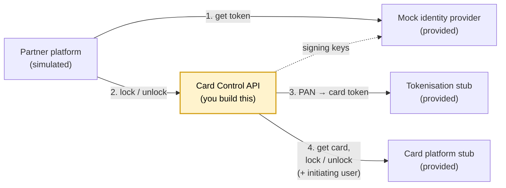

# Take-Home Exercise: Partner Card Control API

Build a small, security-sensitive .NET API that's called by an external partner. It would run on Azure Kubernetes Service (AKS), but the focus for this exercise is the application, it just needs to run locally.

**Time:** spend as much or as little time as you like, and record the total time you spent in your README. We don't expect it to be perfect. What you build should work end to end. Anything you don't get to, or corners you cut, note in your README along with what you'd do with more time.

**Submission:** a link to a Git repository, please keep your commit history, don't squash.

---

## The scenario

A bank issues corporate credit cards. Companies manage their employees' cards through a third-party **partner platform** (a SaaS expense-management product). The bank is building an API the partner calls to perform card operations.

Your job is to build the first slice: **let the partner lock and unlock a card.**

Requirements:

1. **Partner authentication.** The partner gets an access token from the bank's OAuth 2.0 / OIDC authorisation server using the **client credentials** grant. It calls your API with `Authorization: Bearer <JWT>`. The identity provider grants the partner the app role `CardControl.Write`, which appears in its tokens. Your API must only allow callers whose token carries that role. **The starter kit includes a mock identity provider** that issues these tokens.
2. **Card numbers are sensitive.** The partner never sends the card number (PAN) in clear text. It sends the PAN as a **compact JWE** (`alg: RSA-OAEP-256`, `enc: A256GCM`), encrypted with the bank's public key. Every request is over TLS as well. **The starter kit includes a tool** that creates the bank's dev key pair and encrypts PANs the way the partner does.
3. **Entitlement.** The partner may only act on cards that belong to a **corporate** that has been enabled for this partner. Each request includes the `corporateId` the card belongs to, taken from the partner's own records of the corporates it manages. **The partner is enabled for `CORP-1001` and `CORP-2002` only.** Holding that list is your API's responsibility, not the card platform's.
4. **Downstream services.** The bank's card platform works with a **card token**, never the raw PAN. A separate **tokenisation API** exchanges a PAN for its card token. With the token, the card platform returns the card (including its `corporateId` and lock status) and locks or unlocks it. **We provide working stubs of both** in the starter kit (run with `dotnet run`). The starter kit's `README.md` documents their APIs and the seed cards.
5. **Audit.** A real person inside the partner platform starts each action, and the partner sends their ID in an `X-Initiating-User` header. The card platform keeps the audit trail, so it can answer "who locked or unlocked this card, and when?". Your API must pass it the initiating user on every lock and unlock.

### What the partner sends

Every lock or unlock request carries:

| Data | Details |
|---|---|
| Access token | `Authorization: Bearer <JWT>` header |
| Initiating user ID | `X-Initiating-User` header |
| Encrypted PAN | Compact JWE string |
| Corporate ID | e.g. `CORP-1001` |
| Action | Lock or unlock |

Nothing else is sent. How the encrypted PAN, corporate ID and action are carried (route, body, field names), and what your API returns, is up to you.

Anything not stated here is for you to decide. **Write down your assumptions.**

---

## What to build

1. **Card Control API** in **C# / .NET 10** (ASP.NET Core).
   - You design the contract (routes, payloads, status codes, error format).
   - Validate access tokens from the mock identity provider properly: signature, issuer, audience, lifetime and role. Treat it as you would a real OIDC provider.
   - Decrypt the PAN, exchange it for a card token, get the card, and enforce entitlement.
   - Make sure the raw PAN can't end up in logs or error responses.
   - Pass the initiating user to the card platform on every lock and unlock request.
   - Handle the stubs' error responses sensibly. The card platform can also be made slow or flaky (see the starter README). Resilience isn't required, but it's there if you want to show it.
2. **Tests**: automated tests that show your API works.
3. **README** covering:
   - how to run your API alongside the starter kit and make a sample call
   - your assumptions
   - shortcuts you took and what you'd do with more time
   - how much time you spent in total
   - how you used AI tools, if you did. AI tools are fine to use.